<a href="https://merova-project-2.vercel.app">
  
</a>

<h1 align="center">Merova Healthcare — Investor Site</h1>

<p align="center">Pharmaceutical manufacturers, acquired one by one and run as one platform.</p>

<p align="center">
  <a href="https://merova-project-2.vercel.app"></a>
  <a href="https://moumen-alkamsheh.vercel.app/work/merova"></a>
  <a href="https://github.com/mouminkam"></a>
</p>



## Overview

The investor-facing site for **Merova Healthcare**, a fictional holding company that acquires and scales
pharmaceutical manufacturers across **generics**, **contract manufacturing (CMO)** and **specialty products**.

No backend, no database, no API keys: every company, person and figure is invented, and the contact form only
simulates sending. [merova-project-2.vercel.app](https://merova-project-2.vercel.app) is this repository, deployed as-is.

## Highlights

- **A scroll-scrubbed hero, drawn live** — scrolling plays a scene where separate manufacturers are acquired, pulled
  together and locked into one sphere; scroll back and it reverses. It is rendered on canvas from scroll progress, with
  **no images or video**: the whole page is about 420 KB and stays sharp on any screen.
- **An interactive platform** — hover a vertical and its band of the sphere lights up.
- **Charts from the site's own numbers** — market size, a portfolio map by real coordinates, CMO capacity, the
  investment timeline and returns. No charting library.
- **A pinned horizontal thesis** — five panels scrubbed sideways on desktop, stacked on phones.
- **Accessible** — real text everywhere; `prefers-reduced-motion` turns off pinning and animation.

## Architecture

```text
src/
├── app/                layout, page, theme tokens, favicon
├── components/
│   ├── sections/       one file per section: hero, platform, thesis, market, portfolio, returns…
│   ├── providers/      LenisProvider (smooth scroll, synced to GSAP)
│   └── ui/             Navbar, Logo, SectionHeader, Exhibit
└── lib/
    ├── hero-scene.ts   scene generator and canvas renderer, for the hero and the platform explorer
    ├── verticals.ts    the three verticals and their colors
    ├── portfolio.ts    portfolio companies, coordinates and headquarters
    └── gsap.ts, lenis.ts, animations.ts, utils.ts
```

**Data flow:** `lib/*` holds every figure and color → sections read it → `hero-scene.ts` draws the canvas from scroll
progress through GSAP ScrollTrigger.

## Getting started

```bash
npm install
npm run dev        # http://localhost:3000
```

No `.env`, no setup.

## Scripts

| Command | What it does |
| --- | --- |
| `npm run dev` | Development server |
| `npm run build` · `npm start` | Production build · serve it |
| `npm run lint` | ESLint (house config) |
| `npm run typecheck` | `tsc --noEmit` |

CI runs lint, typecheck and the build on every push and pull request.

## Engineering notes

### Color always means a vertical

**Coral** is Generics, **burgundy** is CMO, **peach** is Specialty, and **slate** is an independent manufacturer —
on the hero, the charts and the map alike. All of it comes from one file, `src/lib/verticals.ts`. The logo is the
platform sphere reduced to seven nodes. Type: **Syne** (display), **Inter** (text), **Geist Mono** (labels and figures).

## Honest trade-offs

- The canvas renders on the main thread; it lowers its own resolution when a device can't keep up.
- Pinning the hero for three screens is a showcase choice — shorten it (`h-[400svh]`) on a content-heavy page.
- The portfolio map is a coordinate plot, not a basemap: no coastlines, no tiles.
- The contact form doesn't send anything; replace `handleSubmit` in `ContactSection.tsx` to connect one.
- No automated tests yet — verified with lint (no errors, no warnings), type-checking and production builds.

<a href="https://github.com/mouminkam">
  
</a>
